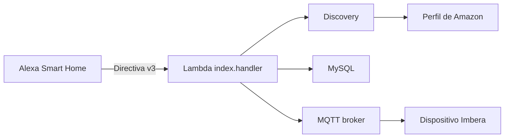

# NegoconVoice

Skill de Alexa Smart Home para descubrir y controlar dispositivos Imbera mediante una Lambda de AWS, una base de datos MySQL y un broker MQTT.

## Qué hace la skill

La skill permite que Alexa:

- Descubra los dispositivos asociados al usuario.
- Envíe comandos de encendido y apagado.
- Consulte el estado reportado de los dispositivos.
- Controle modos del refrigerador mediante `Alexa.ToggleController`.
- Compruebe la conectividad del dispositivo mediante `Alexa.EndpointHealth`.

Esta es una skill **Smart Home**. No utiliza una frase de apertura ni un modelo de interacción personalizado. Alexa reconoce las órdenes según el nombre, la categoría y las capacidades de cada dispositivo descubierto.

## Arquitectura



### Componentes principales

- `skill-package/skill.json`: manifiesto de la skill, locales y ARN de Lambda.
- `ask-resources.json`: configuración de despliegue con ASK CLI.
- `lambda/index.js`: handler principal y construcción de respuestas Alexa.
- `lambda/discovery.js`: obtiene el usuario de Amazon y genera el identificador usado por la base de datos.
- `lambda/bdConnection.js`: consulta los dispositivos del usuario mediante el procedimiento `mac_usuario_alexa`.
- `lambda/mqttConnection.js`: autentica contra MQTT, publica comandos y espera respuestas.
- `lambda/certs/ca_isrg.pem`: certificado CA usado para validar TLS del broker MQTT.

## Flujo de una petición

### 1. Descubrimiento

Cuando el usuario pide descubrir dispositivos:

1. Alexa envía una directiva `Alexa.Discovery`.
2. `discovery.js` consulta `https://api.amazon.com/user/profile` usando el token de Alexa.
3. El `user_id` se convierte a MD5 para consultar la base de datos.
4. `bdConnection.js` ejecuta:

```sql
CALL mac_usuario_alexa(?)
```

5. `index.js` transforma cada fila en un endpoint Alexa.
6. Alexa guarda el dispositivo descubierto.

El nombre visible en Alexa proviene de `Nombre_personalizado`. La categoría proviene de `tipo`.

## Capacidades Alexa

Los endpoints se crean en `lambda/index.js` con estas interfaces:

### `Alexa.PowerController`

Permite órdenes como:

```text
Alexa, enciende la luz del refrigerador
Alexa, apaga la luz del refrigerador
```

### `Alexa.ToggleController`

La skill define estos modos:

- `NightMode`: modo nocturno.
- `FridgeLockMode`: modo bloqueo.
- `ModoAhorroTwo`: modo ahorro.
- `Reset`: modo reset.
- `buzzerSilent`: modo alerta o silencio del buzzer.
- `ReleCerradura`: relé de cerradura.

Ejemplos:

```text
Alexa, activa el modo nocturno
Alexa, desactiva el modo bloqueo
Alexa, activa el modo ahorro
```

### `Alexa.EndpointHealth`

Indica a Alexa si el endpoint tiene conectividad. La respuesta real depende de la comunicación MQTT y del estado reportado por el dispositivo.

## Nombre y categoría del dispositivo

En `lambda/bdConnection.js` se construye cada dispositivo:

```js
return {
    id: device.MAC.replace(/:/g, '').toLowerCase(),
    friendlyName: device.Nombre_personalizado,
    Nombre_difucion: device.Nombre_difucion,
    tipo: 'OTHER'
};
```

Para que Alexa lo trate como una luz, la categoría debería ser compatible con el dispositivo:

```js
tipo: 'LIGHT'
```

El valor debe coincidir con una categoría válida de Alexa y con el tipo real del equipo.

## Variables de entorno

La Lambda necesita estas variables:

```text
DB_HOST
DB_USER
DB_PASSWORD
DB_NAME
DB_SSL
MQTT_USERNAME
MQTT_PRIVATE_KEY
```

Valores recomendados:

```text
DB_SSL=true
```

La clave privada MQTT debe conservar los saltos de línea del formato PEM. No debe guardarse directamente en el código ni en el repositorio. Para producción es preferible usar AWS Secrets Manager y cargar los secretos desde allí.

## Despliegue

Instala las dependencias dentro de `lambda/` si es necesario:

```bash
cd lambda
npm install
cd ..
```

Valida la sintaxis antes de desplegar:

```bash
node --check lambda/bdConnection.js
node --check lambda/discovery.js
node --check lambda/mqttConnection.js
node --check lambda/index.js
```

Antes del primer despliegue, configura estas variables en la función Lambda desde AWS Console, en **Configuration > Environment variables**:

```text
DB_HOST
DB_USER
DB_PASSWORD
DB_NAME
DB_SSL
MQTT_USERNAME
MQTT_PRIVATE_KEY
```

Usa como valor `true` para `DB_SSL` cuando el servidor MySQL requiera TLS. `MQTT_PRIVATE_KEY` debe conservar los saltos de línea del PEM. No guardes los valores en `ask-resources.json`, en el código ni en el repositorio. Si ejecutas `ask deploy` y la función se reemplaza, vuelve a revisar estas variables en la función cuyo ARN aparece en `skill-package/skill.json`.

Después de guardar las variables, valida que existan solo por nombre (sin mostrar sus valores):

```bash
aws lambda get-function-configuration \
    --function-name ask-negoconvoice-default-default-1787253044518 \
    --region us-east-1 \
    --query 'Environment.Variables | keys(@)' \
    --output json
```

Despliega con ASK CLI:

```bash
ask deploy
```

La configuración actual usa:

- Región: `us-east-1`.
- Runtime: Node.js 20.
- Handler: `index.handler`.
- API: Alexa Smart Home, protocolo v3.

La función Lambda también debe tener configurado en AWS el trigger **Alexa Smart Home** asociado al Skill ID.

## Locales e imagen

El manifiesto declara actualmente:

- `en-US`.
- `es-MX`.

La imagen de la skill se configura en Alexa Developer Console y debe existir en sus tamaños requeridos para cada locale. El locale no crea frases personalizadas; únicamente define la información de publicación.

## Seguridad

Antes de publicar esta skill:

1. Rota cualquier contraseña o clave que haya estado escrita en el código.
2. No registres access tokens ni requests completos en CloudWatch.
3. Usa TLS para MySQL cuando el servidor lo permita.
4. Usa AWS Secrets Manager para credenciales MySQL y MQTT.
5. Restringe los permisos IAM de la Lambda al mínimo necesario.
6. No subas archivos con credenciales al repositorio.

## Limitaciones actuales

- `ReportState` mantiene estados en memoria de Lambda. Esos estados pueden perderse cuando Lambda se reinicia y no representan necesariamente el estado físico real del dispositivo.
- La conexión MQTT se mantiene en una variable global y necesita una estrategia adicional para invocaciones simultáneas.
- El código de encendido y apagado usa actualmente el mismo comando base MQTT. Debe confirmarse con el protocolo del dispositivo si `TurnOn` y `TurnOff` requieren comandos distintos.
- No hay una suite de pruebas automatizadas para validar discovery, comandos MQTT y respuestas Alexa.
- La skill Smart Home no acepta frases de apertura como `Alexa, abre NegoconVoice`. Para eso se necesita una Custom Skill separada.

## Pruebas manuales recomendadas

1. Configurar las variables de entorno en Lambda.
2. Verificar que la Lambda tenga el trigger Alexa Smart Home.
3. Ejecutar `ask deploy`.
4. En la aplicación Alexa, desactivar y volver a activar la skill si es necesario.
5. Ejecutar:

```text
Alexa, descubre mis dispositivos
```

6. Probar el nombre exacto mostrado por Alexa:

```text
Alexa, enciende <nombre del dispositivo>
Alexa, apaga <nombre del dispositivo>
Alexa, activa el modo nocturno
Alexa, desactiva el modo nocturno
```

7. Revisar los logs de CloudWatch si el dispositivo no responde.

## Próximas mejoras recomendadas

1. Consultar el estado real del dispositivo por MQTT para responder `ReportState`.
2. Separar la conexión MQTT por invocación o implementar un gestor seguro de conexiones.
3. Confirmar los comandos binarios exactos para encendido y apagado.
4. Crear pruebas unitarias para el discovery, checksum y respuestas Alexa.
5. Mover las credenciales a AWS Secrets Manager.
6. Añadir respuestas Alexa explícitas para errores y directivas no soportadas.
